# SqlX Application Architecture Map (`appMap.md`)

> **AI / Developer Quick Navigation Index**: This document is the single source of truth for the folder and component structure of the SqlX desktop application. Consult this file before modifying or creating features to locate the exact file, props, and dependencies immediately without scanning the entire repository.

---

## 1. Core Architectural Invariants & Rules

1. **Linux / Wayland Crash & Click Freeze Prevention**:
   - [`src-tauri/src/main.rs`](file:///home/mohit/Desktop/Desktop/SqlX-/src-tauri/src/main.rs) and [`src-tauri/src/lib.rs`](file:///home/mohit/Desktop/Desktop/SqlX-/src-tauri/src/lib.rs) **MUST ALWAYS** set `WEBKIT_DISABLE_DMABUF_RENDERER=1` on Linux to prevent WebKitGTK 2.42+ mouse event and rendering deadlocks.
2. **Underline Tab Design Convention**:
   - All tab bars (Results mode tabs, Theme category tabs) use [`UnderlineTab.tsx`](file:///home/mohit/Desktop/Desktop/SqlX-/src/components/ui/atoms/UnderlineTab.tsx) with **no background container**. Active tabs are highlighted with a bottom border and primary accent text: `border-b-2 border-accent-primary text-accent-primary`.
3. **Icons & Style Mandates**:
   - **Extensions Icon**: White `Blocks` icon (`text-white`) everywhere in the application.
   - **JSON Icon**: `Braces` (`{}`).
   - **Appearance / Theme Icon**: No border around the `Palette` icon next to "Appearance".
   - **Results Export**: A single `Export` dropdown button with JSON, CSV, and Copy JSON actions.
4. **Driver Logic Separation**:
   - Common row decoding and metadata logic lives in [`src-tauri/src/drivers/common.rs`](file:///home/mohit/Desktop/Desktop/SqlX-/src-tauri/src/drivers/common.rs). Do not duplicate deserialization loops in individual database driver files.

---

## 2. Component & Data Flow Hierarchy

```mermaid
graph TD
    App["App.tsx (Global Shell & Route State)"]
    TitleBar["layout/TitleBar.tsx"]
    Sidebar["layout/Sidebar.tsx"]
    Rightbar["layout/Rightbar.tsx (Table Schema Inspector)"]
    SidebarNav["layout/sidebar/SidebarNav.tsx"]
    ConnectionList["layout/sidebar/ConnectionList.tsx"]
    SchemaExplorer["layout/sidebar/SchemaExplorer.tsx"]
    
    App --> TitleBar
    App --> Sidebar
    App --> Rightbar
    Sidebar --> SidebarNav
    Sidebar --> ConnectionList
    Sidebar --> SchemaExplorer
    
    App --> HomeView["views/HomeView.tsx"]
    App --> ConnectionsDashboard["connection/ConnectionsDashboard.tsx"]
    ConnectionsDashboard --> ConnectionCard["connection/ConnectionCard.tsx"]
    App --> HistoryView["views/HistoryView.tsx"]
    App --> SavedQueriesView["views/SavedQueriesView.tsx"]
    App --> ExtensionsView["views/ExtensionsView.tsx"]
    App --> ThemeManager["theme/ThemeManager.tsx"]
    ThemeManager --> ThemeCategories["theme/ThemeCategories.tsx"]
    ThemeManager --> ThemeCard["theme/ThemeCard.tsx"]
    ThemeManager --> ThemeEditorModal["theme/ThemeEditorModal.tsx"]
    
    App --> QueryWorkspace["Query View (Default)"]
    QueryWorkspace --> EditorTabBar["editor/EditorTabBar.tsx"]
    QueryWorkspace --> EditorSplitPane["editor/EditorSplitPane.tsx"]
    EditorSplitPane --> SqlEditor["editor/SqlEditor.tsx"]
    EditorSplitPane --> ResultsPanel["results/ResultsPanel.tsx"]
    
    ResultsPanel --> ResultsToolbar["results/ResultsToolbar.tsx"]
    ResultsToolbar --> ExportDropdown["results/ExportDropdown.tsx"]
    ResultsToolbar --> ExtensionsMenu["results/ExtensionsMenu.tsx"]
    ResultsPanel --> GridView["results/views/GridView.tsx"]
    ResultsPanel --> JsonView["results/views/JsonView.tsx"]
    ResultsPanel --> ChartView["results/views/ChartView.tsx"]
    ResultsPanel --> SchemaView["results/views/SchemaView.tsx"]
    ResultsPanel --> RunningStateView["results/views/RunningStateView.tsx"]
    ResultsPanel --> ErrorStateView["results/views/ErrorStateView.tsx"]
    ResultsPanel --> EmptyStateView["results/views/EmptyStateView.tsx"]
```



---

## 3. Quick Feature-to-File Matrix (Instant Lookup)

Use this table to find the target file for any user request or UI update:

| Feature / UI Option You Want to Edit | Primary File | Subcomponents / Helper Files | Key Symbols & State |
|---|---|---|---|
| **Results Panel Mode Tabs** (Grid, JSON, Chart, Schema) | [`src/components/results/ResultsToolbar.tsx`](file:///home/mohit/Desktop/Desktop/SqlX-/src/components/results/ResultsToolbar.tsx) | [`UnderlineTab.tsx`](file:///home/mohit/Desktop/Desktop/SqlX-/src/components/ui/atoms/UnderlineTab.tsx) | `ResultsToolbarProps`, `ResultsTab` |
| **Results Export Actions** (JSON, CSV, Copy JSON) | [`src/components/results/ExportDropdown.tsx`](file:///home/mohit/Desktop/Desktop/SqlX-/src/components/results/ExportDropdown.tsx) | [`src/utils/exportUtils.ts`](file:///home/mohit/Desktop/Desktop/SqlX-/src/utils/exportUtils.ts) | `downloadJsonFile`, `downloadCsvFile`, `copyJsonToClipboard` |
| **Results Data Extensions Menu** (Transformations) | [`src/components/results/ExtensionsMenu.tsx`](file:///home/mohit/Desktop/Desktop/SqlX-/src/components/results/ExtensionsMenu.tsx) | [`src/data/dataExtensions.ts`](file:///home/mohit/Desktop/Desktop/SqlX-/src/data/dataExtensions.ts) | `DATA_EXTENSIONS`, `ExtensionsMenuProps` |
| **Data Transform Algorithms** (Uppercase, Redact, etc.) | [`src/utils/dataTransforms.ts`](file:///home/mohit/Desktop/Desktop/SqlX-/src/utils/dataTransforms.ts) | [`src/data/dataExtensions.ts`](file:///home/mohit/Desktop/Desktop/SqlX-/src/data/dataExtensions.ts) | `applyDataTransform`, `TransformResult` |
| **Results Views: Grid / Virtualized Table** | [`src/components/results/views/GridView.tsx`](file:///home/mohit/Desktop/Desktop/SqlX-/src/components/results/views/GridView.tsx) | [`src/components/grid/DataGrid.tsx`](file:///home/mohit/Desktop/Desktop/SqlX-/src/components/grid/DataGrid.tsx) | `GridView`, TanStack Virtual & Table |
| **Results Views: Syntax-Highlighted JSON** | [`src/components/results/views/JsonView.tsx`](file:///home/mohit/Desktop/Desktop/SqlX-/src/components/results/views/JsonView.tsx) | [`src/utils/jsonHighlight.tsx`](file:///home/mohit/Desktop/Desktop/SqlX-/src/utils/jsonHighlight.tsx) | `JsonView`, `renderHighlightedJson` |
| **Results Views: Bar Chart Visualizer** | [`src/components/results/views/ChartView.tsx`](file:///home/mohit/Desktop/Desktop/SqlX-/src/components/results/views/ChartView.tsx) | - | `ChartView`, column selectors X & Y |
| **Results Views: Schema & Columns Table** | [`src/components/results/views/SchemaView.tsx`](file:///home/mohit/Desktop/Desktop/SqlX-/src/components/results/views/SchemaView.tsx) | - | `SchemaView`, ColumnMetadata list |
| **Results Execution States** (Running, Error, Empty) | [`src/components/results/views/`](file:///home/mohit/Desktop/Desktop/SqlX-/src/components/results/views/) | `RunningStateView`, `ErrorStateView`, `EmptyStateView` | Animated pulse, telemetry, error pre-wrap |
| **Built-in Visual Themes Palette Data** | [`src/data/builtinThemes.ts`](file:///home/mohit/Desktop/Desktop/SqlX-/src/data/builtinThemes.ts) | - | `BUILTIN_THEMES`, `CATEGORIES` |
| **Theme Category Tabs** (All, Light, Dark, Custom) | [`src/components/theme/ThemeCategories.tsx`](file:///home/mohit/Desktop/Desktop/SqlX-/src/components/theme/ThemeCategories.tsx) | [`src/data/builtinThemes.ts`](file:///home/mohit/Desktop/Desktop/SqlX-/src/data/builtinThemes.ts) | `ThemeCategories`, underline styles |
| **Theme Card & Live SQL Syntax Preview** | [`src/components/theme/ThemeCard.tsx`](file:///home/mohit/Desktop/Desktop/SqlX-/src/components/theme/ThemeCard.tsx) | - | `ThemeCard`, preview mini-editor, color pills |
| **Custom Theme Modal & JSON Validator** | [`src/components/theme/ThemeEditorModal.tsx`](file:///home/mohit/Desktop/Desktop/SqlX-/src/components/theme/ThemeEditorModal.tsx) | - | `ThemeEditorModal`, file upload, live JSON preview |
| **Sidebar Navigation Links & New Query CTA** | [`src/components/layout/sidebar/SidebarNav.tsx`](file:///home/mohit/Desktop/Desktop/SqlX-/src/components/layout/sidebar/SidebarNav.tsx) | - | `SidebarNav`, `onNewQuery`, `activeView` |
| **Sidebar Saved Connections List & Renaming** | [`src/components/layout/sidebar/ConnectionList.tsx`](file:///home/mohit/Desktop/Desktop/SqlX-/src/components/layout/sidebar/ConnectionList.tsx) | - | `ConnectionList`, inline rename input, disconnect |
| **Sidebar Schema Explorer (Unified Tree)** | [`src/components/layout/sidebar/SchemaExplorer.tsx`](file:///home/mohit/Desktop/Desktop/SqlX-/src/components/layout/sidebar/SchemaExplorer.tsx) | - | `SchemaExplorer`, hierarchical tree `dbname > table_name > columns` with vertical guide lines (`\|`), table selection, database switcher |
| **Sidebar Resizing & Coordinator** | [`src/components/layout/Sidebar.tsx`](file:///home/mohit/Desktop/Desktop/SqlX-/src/components/layout/Sidebar.tsx) | `sidebar/` subcomponents | Mouse drag resizer (180px–500px) |
| **Table Schema Inspector (Toggleable Rightbar)** | [`src/components/layout/Rightbar.tsx`](file:///home/mohit/Desktop/Desktop/SqlX-/src/components/layout/Rightbar.tsx) | [`UnderlineTab.tsx`](file:///home/mohit/Desktop/Desktop/SqlX-/src/components/ui/atoms/UnderlineTab.tsx) | `Rightbar`, Columns schema, Primary keys, Table info, Quick SQL actions, drag resizer (260px–550px) |
| **Query Editor Tab Bar** (Tabs, Rename, Close, New) | [`src/components/editor/EditorTabBar.tsx`](file:///home/mohit/Desktop/Desktop/SqlX-/src/components/editor/EditorTabBar.tsx) | - | `EditorTabBar`, inline rename, execution time/rows |
| **Editor vs Results Split Pane Resizer** | [`src/components/editor/EditorSplitPane.tsx`](file:///home/mohit/Desktop/Desktop/SqlX-/src/components/editor/EditorSplitPane.tsx) | - | `EditorSplitPane`, vertical drag divider handle |
| **CodeMirror SQL Editor & Keyboard Shortcuts** | [`src/components/editor/SqlEditor.tsx`](file:///home/mohit/Desktop/Desktop/SqlX-/src/components/editor/SqlEditor.tsx) | `@codemirror/lang-sql`, `@codemirror/autocomplete` | `SqlEditor`, F5, selection change |
| **Connections Dashboard & URI Connect Form** | [`src/components/connection/ConnectionsDashboard.tsx`](file:///home/mohit/Desktop/Desktop/SqlX-/src/components/connection/ConnectionsDashboard.tsx) | [`ConnectionCard.tsx`](file:///home/mohit/Desktop/Desktop/SqlX-/src/components/connection/ConnectionCard.tsx) | `ConnectionsDashboard`, URI form, filters |
| **Connection Card in Dashboard** | [`src/components/connection/ConnectionCard.tsx`](file:///home/mohit/Desktop/Desktop/SqlX-/src/components/connection/ConnectionCard.tsx) | - | `ConnectionCard`, test, delete, copy URI, details |
| **Connection Setup Modal Dialog** | [`src/components/connection/ConnectionModal.tsx`](file:///home/mohit/Desktop/Desktop/SqlX-/src/components/connection/ConnectionModal.tsx) | - | `ConnectionModal`, profile form, test connection |
| **Window TitleBar & Controls** | [`src/components/layout/TitleBar.tsx`](file:///home/mohit/Desktop/Desktop/SqlX-/src/components/layout/TitleBar.tsx) | - | `TitleBar`, brand, command palette trigger, execute button, settings, Rightbar inspector toggle (`PanelRight`) |
| **Command Palette (Ctrl+K)** | [`src/components/common/CommandPalette.tsx`](file:///home/mohit/Desktop/Desktop/SqlX-/src/components/common/CommandPalette.tsx) | - | `CommandPalette`, action search |
| **PostgreSQL Database Driver** | [`src-tauri/src/drivers/postgres.rs`](file:///home/mohit/Desktop/Desktop/SqlX-/src-tauri/src/drivers/postgres.rs) | [`common.rs`](file:///home/mohit/Desktop/Desktop/SqlX-/src-tauri/src/drivers/common.rs) | `PostgresAdapter`, PgPool, JSONB decode |
| **MySQL Database Driver** | [`src-tauri/src/drivers/mysql.rs`](file:///home/mohit/Desktop/Desktop/SqlX-/src-tauri/src/drivers/mysql.rs) | [`common.rs`](file:///home/mohit/Desktop/Desktop/SqlX-/src-tauri/src/drivers/common.rs) | `MysqlAdapter`, MySqlPool |
| **SQLite Database Driver** | [`src-tauri/src/drivers/sqlite.rs`](file:///home/mohit/Desktop/Desktop/SqlX-/src-tauri/src/drivers/sqlite.rs) | [`common.rs`](file:///home/mohit/Desktop/Desktop/SqlX-/src-tauri/src/drivers/common.rs) | `SqliteAdapter`, SqlitePool |
| **Tauri IPC Command Endpoints** | [`src-tauri/src/commands/`](file:///home/mohit/Desktop/Desktop/SqlX-/src-tauri/src/commands/) | `connection.rs`, `query.rs`, `schema.rs`, `theme.rs` | `execute_query`, `test_connection`, etc. |

---

## 4. Comprehensive Directory & File Inventory

### `src/components/ui/` (Atomic Design Primitives)
- **`atoms/Button.tsx`**: Reusable button with variants (`primary`, `secondary`, `ghost`, `danger`, `outline`) and sizes (`xs`, `sm`, `md`).
- **`atoms/Input.tsx`**: Standard text input styled to match the dark background with focus rings and error states.
- **`atoms/Badge.tsx`**: Status indicator pill with `accent`, `success`, `warning`, `error`, and `outline` color variants.
- **`atoms/IconButton.tsx`**: Square icon-only button with hover and active states.
- **`atoms/UnderlineTab.tsx`**: Specialized tab button with **no background**, featuring bottom-border highlight when active.
- **`molecules/SearchInput.tsx`**: Search field pre-equipped with search magnifying glass, clear button, and focus styling.
- **`molecules/DropdownMenu.tsx`**: Popover menu container handling click-outside detection and Escape key dismissal.
- **`molecules/Toast.tsx`**: Floating notification badge with animated fade-in and icon.
- **`molecules/Modal.tsx`**: Accessible modal backdrop with backdrop-blur, title bar, and close button.

### `src/components/results/` (Query Results & Visualization)
- **`ResultsPanel.tsx`**: Coordinates query state, passes results to subviews, and handles live execution timers.
- **`ResultsToolbar.tsx`**: Top results bar containing underline mode tabs (`Grid`, `JSON`, `Chart`, `Schema`), active manipulation badge, search input, `ExtensionsMenu`, and `ExportDropdown`.
- **`ExportDropdown.tsx`**: Single button dropdown for exporting JSON, exporting CSV, and copying JSON to clipboard.
- **`ExtensionsMenu.tsx`**: Dropdown popover with a white `Blocks` icon for applying and resetting data transformations.
- **`views/GridView.tsx`**: Displays the active tabular data using [`DataGrid.tsx`](file:///home/mohit/Desktop/Desktop/SqlX-/src/components/grid/DataGrid.tsx).
- **`views/JsonView.tsx`**: Color-syntax-highlighted JSON viewer with row cap metrics.
- **`views/ChartView.tsx`**: Minimalist bar chart visualizer with configurable X (category) and Y (metric) column selectors.
- **`views/SchemaView.tsx`**: Tabular display of column definitions, data types, and nullability.
- **`views/RunningStateView.tsx`**: Animated pulse circle and timer displaying elapsed execution time.
- **`views/ErrorStateView.tsx`**: Error container rendering pre-wrapped database error messages.
- **`views/EmptyStateView.tsx`**: Ready-to-query placeholder display.

### `src/components/theme/` (Appearance & Theming)
- **`ThemeManager.tsx`**: Appearance view coordinator managing search filtering and theme switching.
- **`ThemeCategories.tsx`**: Underline category selector tabs (`All`, `Light`, `Dark`, `Custom`) with no background container.
- **`ThemeCard.tsx`**: Visual card previewing a theme with mini-editor preview, syntax sample, and color discs.
- **`ThemeEditorModal.tsx`**: Modal for creating or importing custom theme JSON with live schema validation.

### `src/components/layout/` (Shell & Structural Organisms)
- **`Sidebar.tsx`**: Master sidebar coordinator managing drag-resize width (180px–500px).
- **`sidebar/SidebarNav.tsx`**: Navigation links (Home, SQL Editor, Connections, History, Saved Queries, Extensions) and "+ New Query" CTA.
- **`sidebar/ConnectionList.tsx`**: Collapsible configured connection list with inline rename, status capsule, and disconnect.
- **`sidebar/SchemaExplorer.tsx`**: Hierarchical multi-database explorer with live database switching, table search filter, expandable columns, primary key badges, and quick queries ("Rows", "Count").
- **`TitleBar.tsx`**: Top window bar with drag region, quick action buttons, and platform window controls.
- **`StatusBar.tsx`**: Bottom footer bar showing connection status and active session info.
- **`ActivityBar.tsx`**: Narrow icon bar for switching views.

### `src/components/editor/` (SQL Query Editing)
- **`SqlEditor.tsx`**: CodeMirror 6 editor equipped with SQL syntax highlighting, auto-completion, line numbers, and F5 query execution.
- **`EditorTabBar.tsx`**: Horizontal query tab strip supporting double-click tab renaming, tab closing, new tab creation, and execution metrics.
- **`EditorSplitPane.tsx`**: Resizable vertical split container between SQL editor and results panel.

### `src/components/connection/` (Database Profiles & Management)
- **`ConnectionsDashboard.tsx`**: Full-page management dashboard with driver filters, search, and URI connection bar.
- **`ConnectionCard.tsx`**: Individual expandable connection profile card with details, test/connect, and copy URI.
- **`ConnectionModal.tsx`**: Dialog modal for adding or editing database connections with host/port/file parameters.

### `src/data/` (Static Data Datasets)
- **`builtinThemes.ts`**: Array of 13 built-in visual themes (Obsidian, Midnight Zinc, Tokyo Night, Dracula, Catppuccin, Nord, Monokai, OLED, Cyberpunk, GitHub Dark Dimmed, Alabaster, GitHub Light, Solarized) and category IDs.
- **`dataExtensions.ts`**: Catalog of data transformation options (transformer, anonymizer, exporter, aggregator).

### `src/utils/` (Pure Helper Utilities)
- **`exportUtils.ts`**: `downloadJsonFile`, `downloadCsvFile`, `copyJsonToClipboard`.
- **`jsonHighlight.tsx`**: Tokenizer that parses raw JSON strings into syntax-colored React elements.
- **`dataTransforms.ts`**: Pure functions for data transforms (casing, trimming, sorting, masking, hashing, totals, markdown/HTML table exports).

### `src/stores/` (Zustand Global State)
- **`connectionStore.ts`**: Manages `connections`, `activeConnectionId`, `schemaTree`, `tableColumns`, `connect()`, `disconnect()`, `refreshSchema()`.
- **`queryStore.ts`**: Manages `tabs`, `activeTabId`, `history`, `savedQueries`, `runActiveQuery()`, `createTab()`, `closeTab()`, `renameTab()`.
- **`themeStore.ts`**: Manages `currentTheme`, `customThemes`, `setTheme()`, `addCustomTheme()`, `removeCustomTheme()`.

### `src/services/`
- **`tauriBridge.ts`**: Type-safe IPC bridge invoking Rust Tauri commands.
- **`themeEngine.ts`**: Applies CSS variables from active theme colors to `document.documentElement`.

---

## 5. Backend Architecture (`src-tauri/src/`)

### `drivers/` (Database Connection Drivers)
- **`mod.rs`**: Declares `DatabaseAdapter` async trait (`ping`, `execute_query`, `get_schema_tree`, `get_table_columns`, `close`) and `create_adapter()` factory.
- **`common.rs`**: Shared macros (`decode_cell_to_json!`, `decode_pg_cell_to_json!`) and helper functions (`extract_columns_metadata`, `finalize_query_result`, `empty_query_result`).
- **`postgres.rs`**: PostgreSQL driver implementation using `sqlx::PgPool` and simple query protocol.
- **`mysql.rs`**: MySQL driver implementation using `sqlx::MySqlPool`.
- **`sqlite.rs`**: SQLite driver implementation using `sqlx::SqlitePool`.

### `commands/` (Tauri IPC Handlers)
- **`connection.rs`**: `test_connection`, `connect_database`, `disconnect_database`.
- **`query.rs`**: `execute_query`.
- **`schema.rs`**: `get_schema_tree`, `get_table_columns`.
- **`theme.rs`**: `get_available_themes`, `load_custom_theme`.

### `models/` (Shared Data Transfer Objects)
- **`connection.rs`**: `ConnectionConfig`, `DatabaseDriver` enum (`postgres`, `mysql`, `sqlite`).
- **`query.rs`**: `QueryRequest`, `QueryResult`, `ColumnMetadata`.
- **`schema.rs`**: `TableSchema`, `ColumnSchema`, `DatabaseTree`.

### `state.rs`
- Contains `AppState` managing `RwLock<HashMap<String, ConnectionConfig>>` and `RwLock<HashMap<String, Arc<Box<dyn DatabaseAdapter>>>>`.

---

## 6. Tauri IPC Endpoint Reference

| Command Name | Input Parameter(s) | Return Type | Called From |
|---|---|---|---|
| `test_connection` | `config: ConnectionConfig` | `bool` | [`src/services/tauriBridge.ts`](file:///home/mohit/Desktop/Desktop/SqlX-/src/services/tauriBridge.ts) |
| `connect_database` | `config: ConnectionConfig` | `String` (connectionId) | [`src/services/tauriBridge.ts`](file:///home/mohit/Desktop/Desktop/SqlX-/src/services/tauriBridge.ts) |
| `disconnect_database`| `connection_id: String` | `()` | [`src/services/tauriBridge.ts`](file:///home/mohit/Desktop/Desktop/SqlX-/src/services/tauriBridge.ts) |
| `execute_query` | `request: QueryRequest` | `QueryResult` | [`src/services/tauriBridge.ts`](file:///home/mohit/Desktop/Desktop/SqlX-/src/services/tauriBridge.ts) |
| `get_schema_tree` | `connection_id: String` | `DatabaseTree` | [`src/services/tauriBridge.ts`](file:///home/mohit/Desktop/Desktop/SqlX-/src/services/tauriBridge.ts) |
| `get_table_columns` | `connection_id: String, table_name: String` | `Vec<ColumnSchema>` | [`src/services/tauriBridge.ts`](file:///home/mohit/Desktop/Desktop/SqlX-/src/services/tauriBridge.ts) |
| `get_available_themes`| None | `Vec<ThemeMetadata>` | [`src/services/tauriBridge.ts`](file:///home/mohit/Desktop/Desktop/SqlX-/src/services/tauriBridge.ts) |
| `load_custom_theme` | `file_path: String` | `serde_json::Value` | [`src/services/tauriBridge.ts`](file:///home/mohit/Desktop/Desktop/SqlX-/src/services/tauriBridge.ts) |

---

## 7. Verification & Build Commands

When making any modification, run these commands to ensure zero regression:
```bash
# 1. Format and check linter (Biome + Oxlint)
npm run lint

# 2. Automatically fix formatting
npm run lint:fix

# 3. Verify TypeScript types
npm run typecheck

# 4. Verify frontend production build
npm run build

# 5. Verify Rust backend compilation
cargo check --manifest-path src-tauri/Cargo.toml
```
